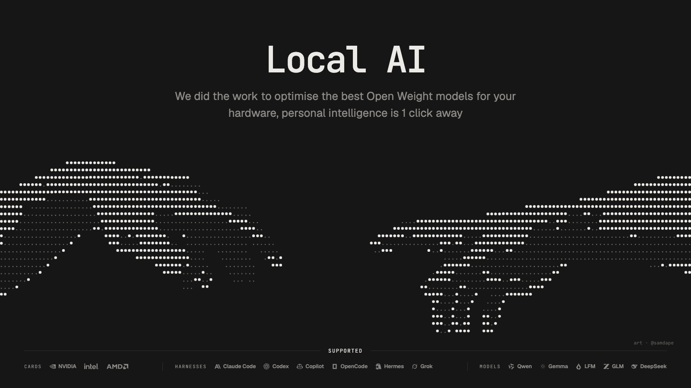

# Local AI for Omarchy

Run a model on your own GPU and open a coding agent on it, from the Omarchy bar.

Local AI picks a model that was tested on your exact card, downloads and checks it, runs it in Docker, and opens
Claude Code, Codex, pi, OpenCode or another agent on it in a folder you choose. Nothing leaves your machine.



## Install

```bash
omarchy plugin add https://github.com/0xSero/omarchy-local-ai --enable
```

Then:

1. Open **Local AI** in the bar and click **Set up Local AI**. This is needed once per machine, and Omarchy asks for your password ([what setup does](docs/security.md#setup)).
2. On the **models** tab, pick a model and click **Start**. The first start downloads the weights, which can take a while.
3. When it is ready, click **Open** to start your coding agent on it.

Updates show up on the home tab as **Update Local AI**. Something went wrong? See [troubleshooting](docs/troubleshooting.md).

## Supported hardware

Every model listed was downloaded, loaded, checked for correct answers and timed on that exact card. A machine with
no tested model says so in the panel.

<!-- cards: generated from recipes.json by `make docs` -->
| Maker | Cards |
|---|---|
| NVIDIA | DGX Spark (GB10) 128 GB unified, GTX 1080 Ti 11 GB, RTX 2000 Ada 16 GB, RTX 3060 12 GB, RTX 3060 Ti 8 GB, RTX 3070 8 GB, RTX 3070 Laptop 8 GB, RTX 3070 Ti 8 GB, RTX 3080 10 GB, RTX 3080 Ti 12 GB, RTX 3090 24 GB, RTX 3090 Ti 24 GB, RTX 4000 Ada 20 GB, RTX 4060 8 GB, RTX 4060 Laptop 8 GB, RTX 4060 Ti 8 GB, RTX 4060 Ti 16 GB, RTX 4070 12 GB, RTX 4070 SUPER 12 GB, RTX 4070 Ti 12 GB, RTX 4070 Ti SUPER 16 GB, RTX 4080 16 GB, RTX 4080 SUPER 16 GB, RTX 4090 24 GB, RTX 5060 8 GB, RTX 5060 Ti 8 GB, RTX 5060 Ti 16 GB, RTX 5070 12 GB, RTX 5070 Ti 16 GB, RTX 5070 Ti Laptop 12 GB, RTX 5080 16 GB, RTX 5080 Laptop 16 GB, RTX 5090 32 GB, RTX 5090 Laptop 24 GB, RTX 6000 Ada 48 GB, RTX A6000 48 GB, RTX PRO 4000 Blackwell 24 GB, RTX PRO 4500 Blackwell 32 GB, RTX PRO 6000 Blackwell 96 GB, RTX Spark N1X 128 GB unified |
| Intel | Arc B390 64 GB unified, Arc Pro B65 32 GB, Arc Pro B70 32 GB |
| AMD | Instinct MI300X 192 GB, Radeon RX 7900 XT 20 GB, Radeon RX 9070 XT 16 GB |
| CPU | any x86-64 CPU with AVX2, Apple M1 8 GB |
<!-- /cards -->

The full list of models per card is in [local-ai-registry](https://github.com/sybil-solutions/local-ai-registry/blob/main/supported/README.md).
Your card isn't there? The registry pays for new recipes ([bounties](https://github.com/sybil-solutions/local-ai-registry/issues?q=is%3Aissue+is%3Aopen+label%3Abounty)).

## Requirements

- Omarchy with its bar.
- Docker 28 or later (Omarchy ships 29).
- NVIDIA: the driver. Setup installs the container toolkit.
- AMD: ROCm's `amd-smi`.
- Enough disk for the model. The panel shows each model's size, and the RAM and disk it needs, before you start it.
- Optional: Tailscale, to share a model with your other machines. A Hugging Face token in `~/.cache/huggingface/token` is used for downloads if you have one.

## Agents

pi, Claude Code, Codex, OpenCode, omp, Crush, Grok, Copilot and Hermes. Local AI opens the agent in a terminal,
already pointed at your model. It does not change the agent's own config.

To use the model from another tool, open the model's page and copy its address under **this machine**. The key is in
`~/.local/state/omarchy/local-ai/gateway.key`. The gateway speaks the OpenAI, Anthropic and Responses APIs.

## From a shell

Everything the panel does is also a command. The backend is one script in the plugin folder:

```bash
alias omarchy-local-ai=~/.config/omarchy/plugins/sero.local-ai/bin/omarchy-local-ai

omarchy-local-ai setup                       # one-time machine setup
omarchy-local-ai run <recipe> <gpu>          # e.g. run qwen38-27b-exl3-3bpw-rtx3090-sglang-tp1 nvidia:0
omarchy-local-ai stop <recipe>
omarchy-local-ai open <recipe>               # open the chosen agent on it
omarchy-local-ai download <recipe> [off]     # download without starting, or cancel
omarchy-local-ai forget <recipe>             # delete a stopped model's weights
omarchy-local-ai share <recipe> [off]        # share on your tailnet
omarchy-local-ai set agent|folder <value>    # default agent and folder
omarchy-local-ai set ping on|off             # anonymous usage counts
omarchy-local-ai registry                    # check for catalog changes now
omarchy-local-ai log
```

## Privacy

Your prompts and answers stay on your machine. Local AI sends nothing about you or your use unless you allow
anonymous usage counts, which it asks about once. [docs/privacy.md](docs/privacy.md) shows exactly what is sent.

## Remove

```bash
~/.config/omarchy/plugins/sero.local-ai/bin/omarchy-remove-ai-local   # stops models, deletes containers, images, weights, settings
omarchy plugin remove sero.local-ai
```

## More

- [docs/troubleshooting.md](docs/troubleshooting.md): an error message and what to do about it.
- [docs/security.md](docs/security.md): what setup changes, how models are isolated, and the gateway key.
- [docs/catalog.md](docs/catalog.md): how new models arrive, downloads, and removal.
- [docs/privacy.md](docs/privacy.md): the usage counts, field by field.
- [docs/legacy-polkit.md](docs/legacy-polkit.md): the red banner about files left by Local AI 6.0-6.4.
- [docs/design.md](docs/design.md): how the plugin works inside, for contributors.
- [docs/releases.md](docs/releases.md): branches and releases.

## License

[MIT](LICENSE). Model-maker marks in `Logos.js` come from [lobe-icons](https://github.com/lobehub/lobe-icons) (MIT) and, for Intel and AMD, [Simple Icons](https://simpleicons.org) (CC0). The agent, model-maker and GPU-maker logos are trademarks of their owners, shown to identify compatibility only; Local AI is not affiliated with or endorsed by any of them.
